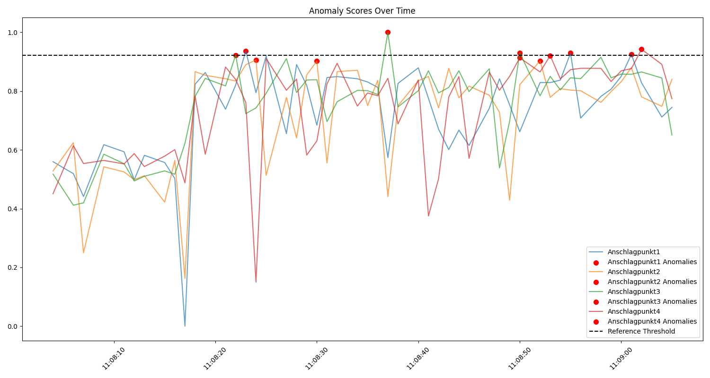
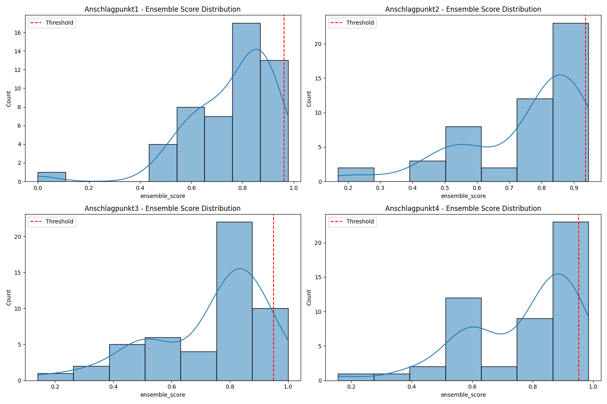
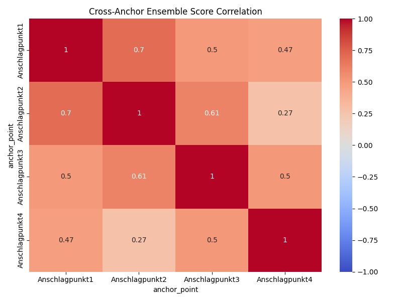
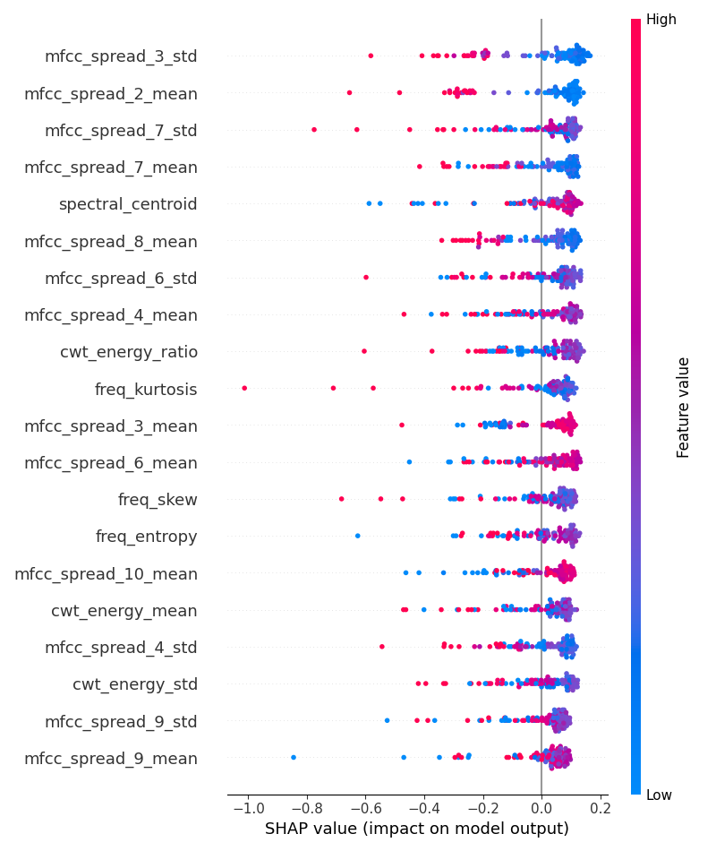

<picture><source media="(prefers-color-scheme: dark)" srcset="https://raw.githubusercontent.com/OnsKoukiPro/Failure-Detection-AE/main/.github/assets/banner-dark.svg?v=r1"></picture>

<picture><source media="(prefers-color-scheme: dark)" srcset="https://raw.githubusercontent.com/OnsKoukiPro/Failure-Detection-AE/main/.github/assets/stats-dark.svg?v=r1"></picture>

<picture><source media="(prefers-color-scheme: dark)" srcset="https://raw.githubusercontent.com/OnsKoukiPro/Failure-Detection-AE/main/.github/assets/s1-dark.svg?v=r1"></picture>

<picture><source media="(prefers-color-scheme: dark)" srcset="https://raw.githubusercontent.com/OnsKoukiPro/Failure-Detection-AE/main/.github/assets/pipeline-dark.svg?v=r1"></picture>

Each recording is cleaned (normalise, band-pass, trim, mono) and turned into time-domain, spectral, MFCC and wavelet features. Unsupervised detectors score each one, and an ensemble with a per-impact-point threshold makes the call. Supervised paths (random forest, CNN on spectrograms, LSTM) live in `src/` and `src/KI2/`.

<picture><source media="(prefers-color-scheme: dark)" srcset="https://raw.githubusercontent.com/OnsKoukiPro/Failure-Detection-AE/main/.github/assets/s2-dark.svg?v=r1"></picture>

<picture><source media="(prefers-color-scheme: dark)" srcset="https://raw.githubusercontent.com/OnsKoukiPro/Failure-Detection-AE/main/.github/assets/lanes-dark.svg?v=r1"></picture>

<details>
<summary><b>More plots</b></summary>

| | |
|---|---|
|  |  |
|  |  |

</details>

<details>
<summary><b>Run it</b></summary>

Everything runs in Docker through the `makefile`, one target per step:

```bash
make map-ki        # 1. link each WAV to its metadata
make process-ki    # 2. normalise, filter, trim
make help          # all steps: features, training, validation, analysis
```

Labels: `good` is 0, `Frequency not good` and `Quotient not good` are 1. Splits are chronological (80 / 10 / 10) and stratified for the class imbalance.

</details>
